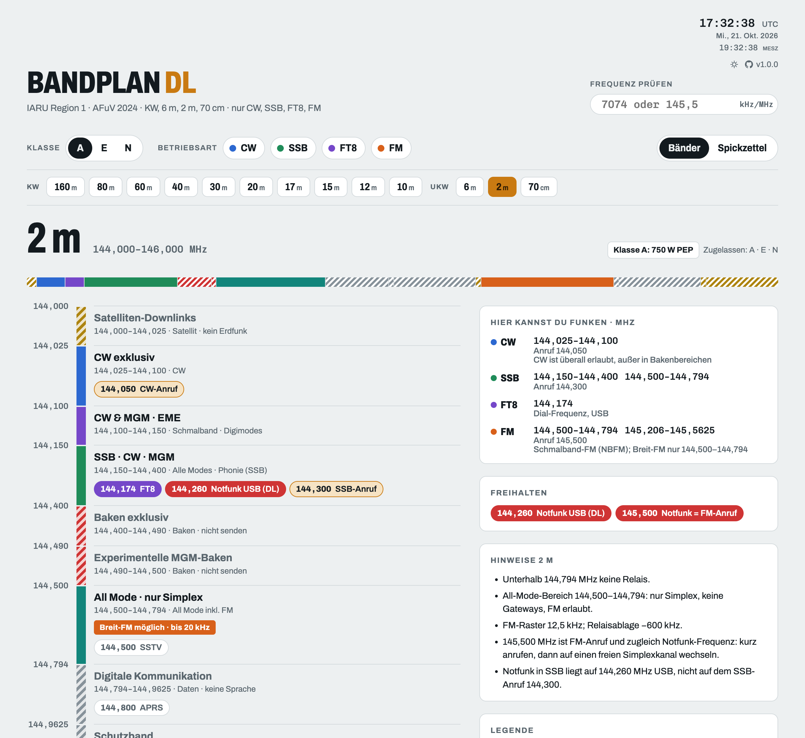
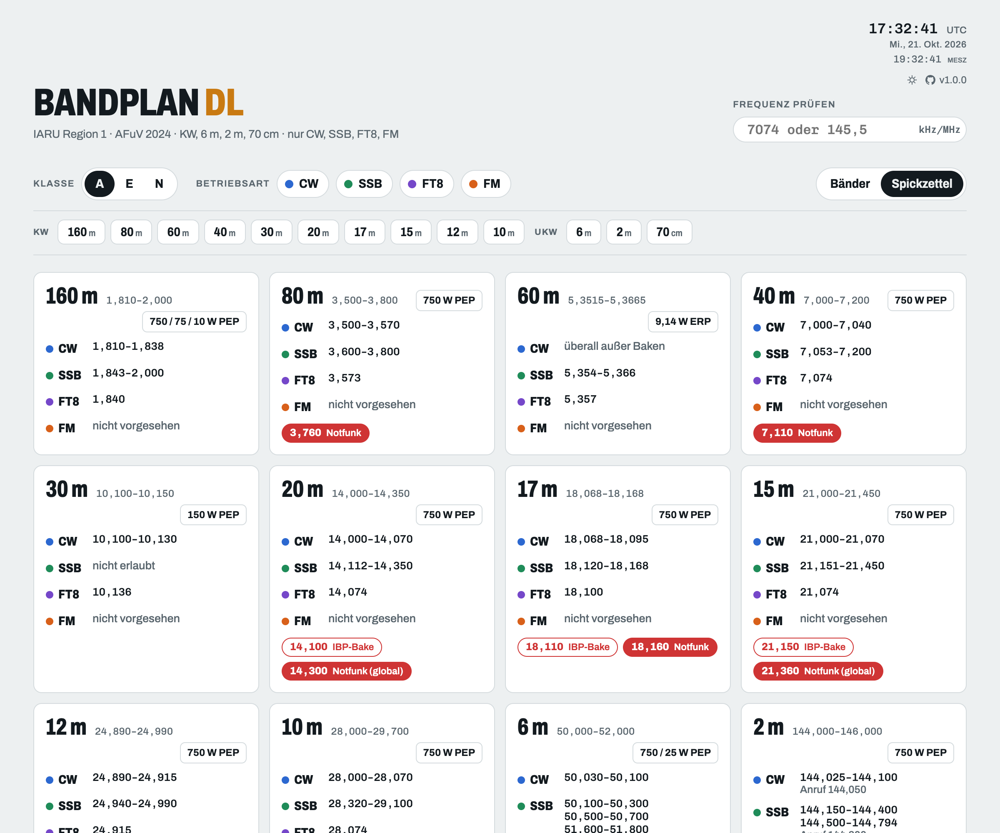
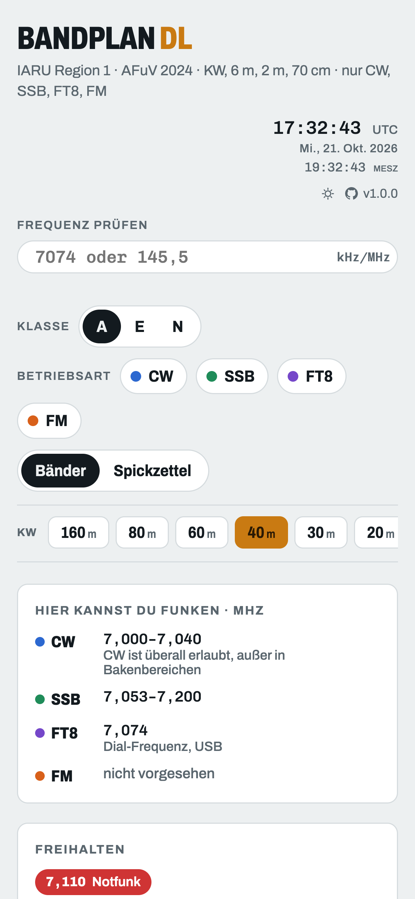

# Bandplan DL

Interaktiver Amateurfunk-Bandplan für Deutschland als statische Webseite: KW (160–10 m), 6 m, 2 m und 70 cm nach IARU Region 1, mit Lizenzklassen und Leistungen aus der AFuV. Gedacht für Handy und Rechner, auch für den Portabelbetrieb (POTA).



## Funktionen

- **Klasse und Betriebsart wählen.** Klasse A, E oder N sowie CW, SSB, FT8 und FM. Die Auswahl bleibt im Browser gespeichert (`localStorage`). Bänder, die die Klasse nicht nutzen darf, sind durchgestrichen. Mindestens eine Betriebsart bleibt immer aktiv.
- **Frequenzleiter pro Band.** Farbige Segmente; Relais-, Baken-, Satelliten- und Datenbereiche sind schraffiert (kein Simplex). Notfunkfrequenzen rot, Anruffrequenzen hervorgehoben, FT8-Dial-Frequenzen lila.
- **„Hier kannst du funken“.** Pro Betriebsart die nutzbaren Bereiche, Anruf- und FT8-Frequenzen. Im FM-Modus zeigt jedes FM-Segment, ob nur NBFM (±2,5 kHz Hub) oder auch Breit-FM zulässig ist.
- **Spickzettel.** Alle Bänder auf einen Blick, druckbar auf A4 (Browser-Druck).
- **Frequenz prüfen.** Eingabe in kHz (`7074`), MHz (`145,5`) oder Hz (`14074000`). Zeigt Segment, passende Betriebsarten, FM-Bandbreite und warnt vor Notfunk- und Bakenfrequenzen in der Nähe. `Enter` springt ins Band, `Esc` löscht.
- **Direktlinks.** `#40` öffnet ein Band, `#f=7.074` prüft eine Frequenz, `#spick` öffnet den Spickzettel.
- **Kopfbereich** wie bei MUF Muncher: UTC-Uhr mit Datum und Ortszeit, Hell/Dunkel-Umschalter (ohne eigene Wahl gilt die Systemeinstellung; die Wahl bleibt im Browser gespeichert) und die laufende Version mit Link zum Quellcode.

<p> </p>

## Verwendung

Kein Build, keine Abhängigkeiten. `index.html` direkt im Browser öffnen oder lokal ausliefern:

```bash
python3 -m http.server 8770
```

Danach <http://localhost:8770> öffnen. Zum Hosten reicht jeder statische Webserver (nginx, Forgejo/GitHub Pages, …); alle Pfade sind relativ.

### Build

`tools/build.sh [Zielordner]` (Standard `dist/`, relativ zum Repo) kopiert die auslieferbaren Dateien (`index.html`, `impressum.html`, `assets/`) und hängt an jede JS/CSS-Referenz `?v=<Hash>` an. So holt der Browser nach einem Deploy sofort die neuen Dateien, auch wenn Cloudflare sie sonst 4 Stunden cachen würde. Docker und Cloudflare Pages nutzen beide dieses Skript; zum lokalen Entwickeln ist kein Build nötig.

### Cloudflare Pages (Produktion)

Live unter <https://bandplan-dl.sammet.me>. Jeder Push auf `main` im GitHub-Repo startet [`.github/workflows/deploy.yml`](.github/workflows/deploy.yml). Der Workflow prüft die Daten (`node tools/validate.js`), baut nach `dist/`, legt die Sicherheits-Header aus [`_headers`](_headers) dazu und deployt mit `wrangler pages deploy` in das Pages-Projekt `bandplan-dl`. Das Projekt muss existieren (einmalig: `npx wrangler pages project create bandplan-dl --production-branch=main`). Manuell starten geht über *Actions → Run workflow*. Welche Version live ist, zeigt der Build-Stempel im Footer („Stand: <Commit> · <Datum>“).

Benötigte Repository-Secrets: `CLOUDFLARE_API_TOKEN` (Recht: *Cloudflare Pages – Edit*) und `CLOUDFLARE_ACCOUNT_ID`. Die eigene Domain wird einmalig im Pages-Projekt unter *Custom domains* eingetragen.

Ist für die Zone Web Analytics (RUM) mit automatischer Einbindung aktiv, fügt Cloudflare auf der eigenen Domain `beacon.min.js` ein. Die CSP blockiert das (Konsolenfehler), und es widerspräche „kein Tracking“ im Impressum. Abhilfe im Free-Tarif: in der Zone unter *Rules → Configuration Rules* eine Regel „Hostname equals bandplan-dl.sammet.me“ mit der Einstellung *Disable Real User Monitoring (RUM)* anlegen.

### Docker

Ein schlankes Image auf Basis von `nginx-unprivileged` (läuft ohne root auf Port 8080) liefert die Ausgabe von `tools/build.sh` aus:

```bash
docker compose up -d --build
```

Danach läuft die Seite auf <http://localhost:8095>. Einen anderen Port setzt du mit `BANDPLAN_PORT=9000 docker compose up -d` oder in einer `.env`. Der Container ist gehärtet: read-only Dateisystem, keine Capabilities, 64 MB RAM. Er hat einen Healthcheck auf `/healthz`. Die Sicherheits-Header (u. a. CSP) stehen in `nginx.conf` (für Pages gleichlautend in `_headers`). HTML, JS und CSS werden mit `Cache-Control: no-cache` ausgeliefert, damit ein neues Deploy sofort sichtbar ist.

Ohne Compose geht es so:

```bash
docker build -t bandplan-dl .
docker run -d --name bandplan-dl -p 8095:8080 --read-only --tmpfs /tmp bandplan-dl
```

Hinter einem Reverse Proxy (Traefik, Caddy, nginx) einfach auf Port 8080 des Containers zeigen.

### Offline

Die Seite braucht keine externen Ressourcen: Die Schriften (Archivo, Chivo Mono) liegen selbst gehostet in `assets/fonts/` (Lizenz: SIL OFL 1.1, siehe `assets/fonts/LICENSE.md`). Es gibt keine Verbindung zu Google oder anderen Dritten; Besucher-IPs landen nirgends außer auf dem eigenen Server.

## Aufbau

| Datei | Inhalt |
|---|---|
| `index.html` | Seitengerüst |
| `impressum.html` | Impressum und Datenschutzhinweis (verlinkt im Footer) |
| `assets/data.js` | Bandplan-Daten: Segmente, Marken, Klassen/Leistungen, Hinweise, FM-Bandbreiten |
| `assets/app.js` | Rendering, Frequenz-Check, Zustand und Direktlinks |
| `assets/app.css` | Styles inkl. Dark Mode und Druck |
| `assets/fonts.css`, `assets/fonts/` | Selbst gehostete Schriften (woff2, Ausschnitte latin und latin-ext) |
| `tools/validate.js` | Konsistenzprüfung der Daten |
| `tools/build.sh` | Build nach `dist/` mit Cache-Busting |
| `_headers`, `.github/workflows/deploy.yml` | Cloudflare Pages: Sicherheits-Header und automatischer Deploy |
| `Dockerfile`, `nginx.conf`, `docker-compose.yml` | Container zum Deployen |
| `docs/DATA.md` | Datenmodell, Quellen, bewusste Vereinfachungen |

## Daten pflegen

Alle Inhalte stehen in [`assets/data.js`](assets/data.js), Frequenzen in kHz. Datenmodell und Quellen: [`docs/DATA.md`](docs/DATA.md). Nach jeder Änderung:

```bash
node tools/validate.js
```

Das Skript prüft, dass die Segmente jedes Band lückenlos abdecken, alle Marken im Band liegen und die FM-Bandbreiten-Einträge zu Segmenten passen.

## Grenzen

- Der Bandplan ist eine **Empfehlung** der IARU; rechtlich verbindlich sind nur Frequenzbereiche, Leistungen und Bandbreiten der AFuV.
- Der nationale DARC-Plan kann im Detail abweichen, besonders bei der 70-cm-Relaisbelegung. Für Relais immer die aktuelle Relaisliste prüfen.
- Nur die Betriebsarten CW, SSB, FT8 und FM sind ausgewertet; andere Digimodes, DV, ATV usw. erscheinen nur als Segmentbezeichnung oder Marke.
- Bänder unter 160 m (2200 m, 630 m) und oberhalb 70 cm sind nicht enthalten.

## Quellen

- [IARU R1 HF Bandplan (gültig ab 16.10.2020)](https://www.iaru-r1.org/wp-content/uploads/2021/06/hf_r1_bandplan.pdf)
- [IARU R1 VHF Handbook 10.03 (Feb. 2026)](https://www.iaru-r1.org/wp-content/uploads/2026/02/VHF_Handbook_V10_03_final.pdf)
- [IARU R1 UHF Bandplan 2020 (via IRTS)](https://www.irts.ie/dnloads/IARU-R1-Bandplan-UHF-2020.pdf)
- [AFuV Anlage 1](https://www.gesetze-im-internet.de/afuv_2005/anlage_1.html)
- [DARC Notfunk-Frequenzen (2022-09-13)](https://www.mikrocontroller.net/attachment/570850/darc_notfunk_Notfunkfrequenzen_2022-09-13.pdf)

## Release erstellen

Versionen nach Semantic Versioning, Änderungen stehen in [`CHANGELOG.md`](CHANGELOG.md). Die Versionsnummer steht als `VERSION` oben in [`assets/app.js`](assets/app.js) und wird im Kopf und im Footer angezeigt.

1. `VERSION` in `assets/app.js` erhöhen und in `CHANGELOG.md` einen Abschnitt `## [x.y.z] - JJJJ-MM-TT` samt Link unten anlegen.
2. Committen, taggen und auf beide Remotes pushen. Der Push nach GitHub deployt die neue Version.
   ```bash
   git commit -am "Release vX.Y.Z"
   git tag -a vX.Y.Z -m "vX.Y.Z"
   git push private main --tags
   git push origin main --tags
   ```
3. GitHub-Release mit den Notizen aus dem Changelog anlegen:
   ```bash
   gh release create vX.Y.Z --repo mooxle/bandplan-dl --title vX.Y.Z --notes "$(awk '/^## \[X.Y.Z\]/{f=1;next} /^## \[/{f=0} f && !/^\[[0-9]/' CHANGELOG.md)"
   ```

## Lizenz

Code und Daten: [MIT](LICENSE). Die Schriften in `assets/fonts/` stehen unter der SIL Open Font License 1.1 ([`assets/fonts/LICENSE.md`](assets/fonts/LICENSE.md)).
