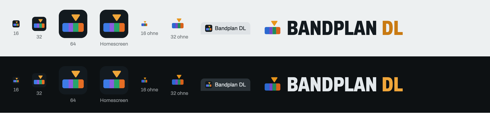

# Icon und Marke



## Idee

Ein Bandplan in Miniatur: ein Balken aus vier farbigen Segmenten (wie die Übersichtsleiste über jeder Frequenzleiter) und darüber ein Zeiger, der auf eine Frequenz zeigt – wie der Frequenz-Check. Die Segmentfarben sind die der Betriebsarten auf der Seite, der Zeiger hat die Akzentfarbe von „DL“ im Schriftzug.

Die Grundidee stammt aus einem Entwurf mit Gemini (Balken mit Segmenten, Strichen und Zeiger). Der Entwurf selbst taugte nicht als Icon: Das Seitenverhältnis von etwa 5 : 1 ergibt im quadratischen Favicon nur einen dünnen Streifen, Striche und Funkbögen verschwinden bei 16 px, und die Transparenz war als Schachbrett ins Bild gemalt. Die Dateien hier sind deshalb von Hand als SVG gezeichnet: kompakter, vier Segmente, ohne Striche und Bögen, echt transparent.

## Dateien

| Datei | Verwendung | Inhalt |
|---|---|---|
| [`assets/icon.svg`](../assets/icon.svg) | Favicon (`<link rel="icon">`) | dunkle Kachel `#131a1f` mit Rundung, aufgehellte Farben für Kontrast |
| [`assets/apple-touch-icon.png`](../assets/apple-touch-icon.png) | Homescreen iOS/Android, 180 × 180 px | wie `icon.svg`, aber ohne Rundung (iOS rundet selbst) |
| [`assets/mark.svg`](../assets/mark.svg) | vor dem Schriftzug im Kopf von Seite und Impressum | nur Balken und Zeiger, transparent |

Alle drei laufen im Build durch das Cache-Busting (`?v=<Hash>`), eine Änderung ist nach dem Deploy also sofort sichtbar.

## Farben

| Element | Marke (`mark.svg`) | Favicon auf dunkler Kachel (`icon.svg`) | entspricht auf der Seite |
|---|---|---|---|
| Segment 1 | `#2c68d0` | `#3d7be6` | CW |
| Segment 2 | `#7547c9` | `#8a5ce0` | Schmalband/Digimodes, FT8 |
| Segment 3 | `#1f8c59` | `#27a56a` | SSB |
| Segment 4 | `#d8601a` | `#e66d24` | FM |
| Zeiger | `#e8951c` | `#f0a63a` | Akzent („DL“) |
| Kachel | – | `#131a1f` | Textfarbe im hellen Modus |

Die Segmentbreiten sind bewusst ungleich (wie echte Bandsegmente), der Zeiger steht über der Grenze zwischen Grün und Orange.

## Ändern

1. SVG in `assets/` bearbeiten (Koordinaten im 32er-Raster halten, damit es bei 16 und 32 px scharf bleibt).
2. Apple-Touch-Icon neu erzeugen: `icon.svg` ohne `rx` auf der Kachel als 180 × 180 px rendern (z. B. in Chrome als Inline-SVG mittig in einem 500 × 500-Fenster, Screenshot, dann `sips -c 180 180`).
3. Vorschau prüfen und Bild aktualisieren: lokalen Server starten (`python3 -m http.server 8770`), [`icon-preview.html`](icon-preview.html) öffnen, Screenshot als `docs/icon-preview.png` speichern:
   ```bash
   "/Applications/Google Chrome.app/Contents/MacOS/Google Chrome" --headless=new --hide-scrollbars --force-device-scale-factor=2 --window-size=1100,260 --virtual-time-budget=3000 --screenshot=docs/icon-preview.png http://localhost:8770/docs/icon-preview.html
   ```
